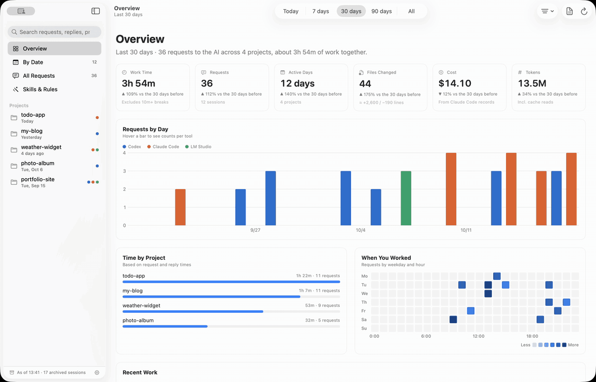
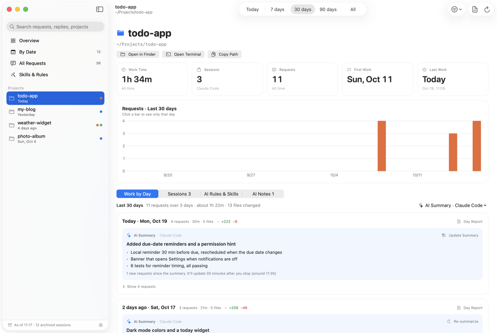
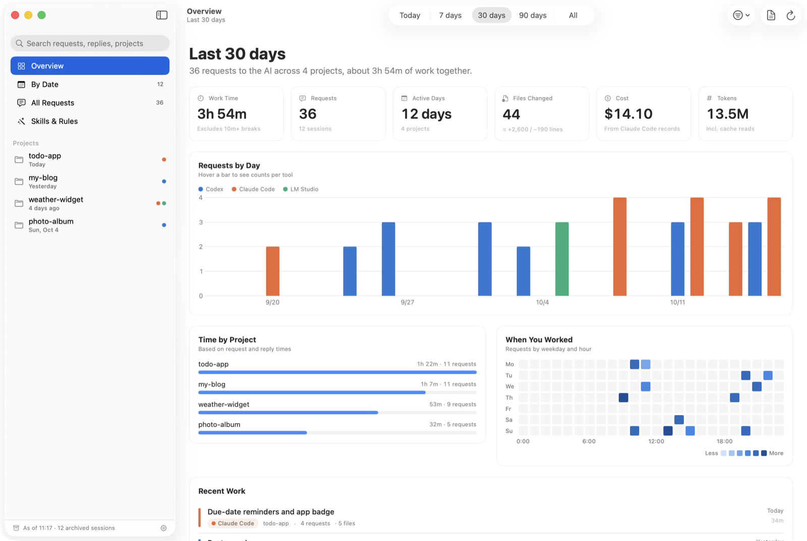
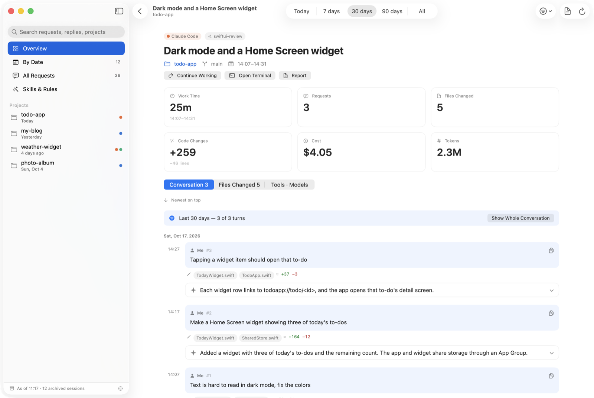
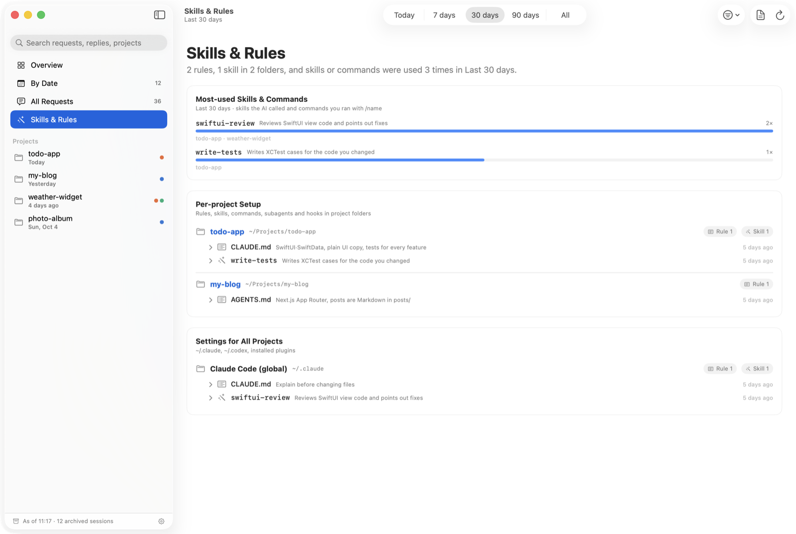
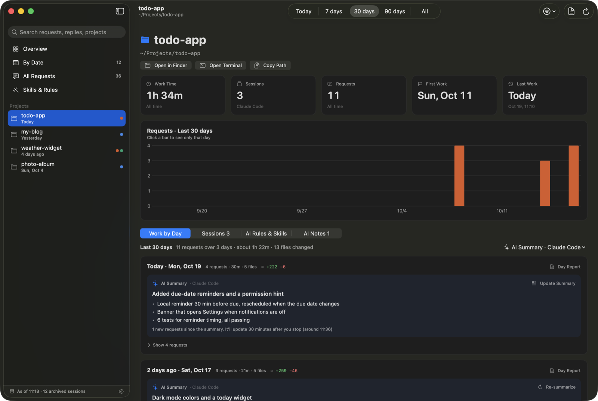
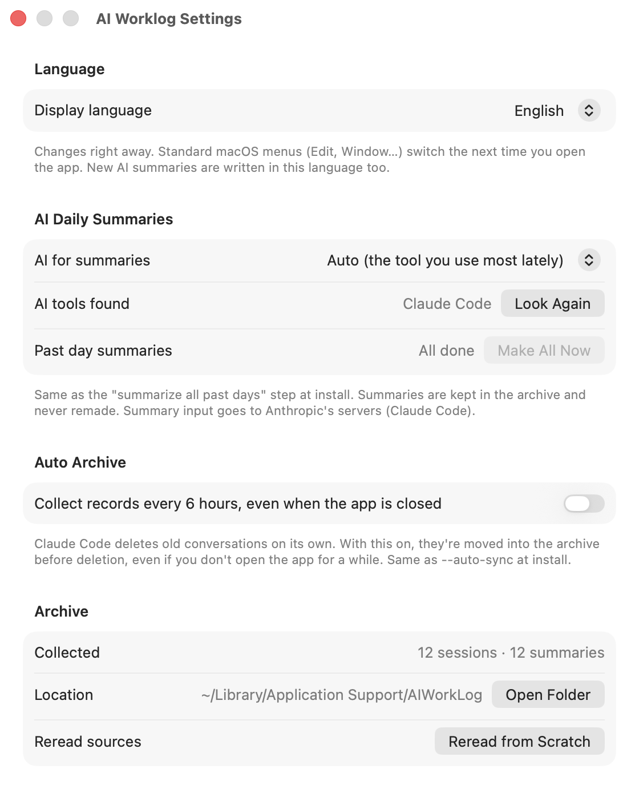

# AI Worklog

[한국어](README.md) · **English**

<p align="center">
  
  <br><sub>20-second demo (<a href="docs/demo-en.mp4">watch as MP4</a>) · recorded with made-up sample data</sub>
</p>

A macOS app that collects what you did with AI coding tools — **Claude Code, Codex and LM Studio** — on your Mac, and shows it as a **day-by-day work log**.

<p align="center">
  <a href="https://github.com/whalebanana86/ai-worklog/releases/latest"><b>⬇︎ Download (macOS 14+, Apple silicon & Intel)</b></a>
</p>

## Why?

When you hand a lot of work to an AI, a few things happen:

1. **"So what did I actually get done?"** — after dozens of requests a day, it's hard to remember what was finished.
2. **The records are long and scattered** — each tool keeps its history in a different place and format, often as huge machine-oriented logs.
3. **The records disappear** — Claude Code deletes old conversations on its own, so last month's work can vanish.

AI Worklog:

- **gathers** those records in one place,
- **archives** them on your Mac before they are deleted, and
- **condenses** each day into a few lines of "what got done", written by the AI tool you already use.



> All screenshots here use made-up sample data (a to-do app, a blog, a weather widget and a photo album). Launch the app with `--demo` to see the same thing.

## Install

### Download (easiest)

1. Download `AI-Worklog-…-macOS.dmg` from the [Releases page](https://github.com/whalebanana86/ai-worklog/releases/latest).
2. Open it and drag the app onto the **Applications** folder next to it.
3. Open the app from Applications.
   - If macOS says it can't verify the developer, go to **System Settings → Privacy & Security** and click **Open Anyway** at the bottom. (Builds that aren't notarized yet need this once; notarized builds open right away.)
   - Or, in Terminal: `xattr -dr com.apple.quarantine "/Applications/AI 작업일지.app"`
4. The first launch reads all your AI records once, which takes a moment. To make AI summaries for all past days at once, open **Settings (⌘,) → Make All Now**.

### Build from source

Requirements: macOS 14 Sonoma or later, Xcode or the Command Line Tools (`xcode-select --install`).
Optional: Claude Code, Codex or LM Studio — needed only for AI summaries; the app works without them.

```bash
git clone https://github.com/whalebanana86/ai-worklog.git
cd ai-worklog
scripts/build_app.sh --install
```

This builds the app into `~/Applications`, reads your existing AI records into the archive, and asks your AI tool to summarize each past day once (a few minutes if you have a lot of history). Summaries are stored, so they are never generated twice. Add `--no-summary` to skip the summaries.

### Update · uninstall

- **Update:** replace the app with the new DMG, or `git pull` and run `scripts/build_app.sh --install` again. Your archive and summaries are kept.
- **Uninstall:** move the app to the Trash. To remove the collected data too, delete `~/Library/Application Support/AIWorkLog`.

## Usage



| Sidebar | What it shows |
|---|---|
| Overview | How long you worked with AI, how many requests, which days and projects, cost and tokens |
| By Date | What you did each day, in which project |
| All Requests | Every request you sent to an AI, searchable |
| Skills & Rules | Rules and skills you set up for your AI tools, and which ones get used most |
| Projects | One page per project (below) |

### The project page — the heart of the app

1. Click a project in the sidebar.
2. The **Work by Day** tab has one card per day.
3. The **AI Summary** box at the top of each card is a one-line headline plus the key results. Unfinished work is listed as "To do".
4. Click **Show N requests** for details: what you asked → what the AI did → which files changed.
5. Click a request to open the full conversation.



### When is today summarized?

- Not while you're working. Once 30 minutes pass after your last request, the day is summarized. The card tells you when ("around 11:30").
- Don't want to wait? Click **Summarize Now**.
- If today already has a summary, only the **new requests** are sent and merged in, which uses fewer tokens than starting over.
- When the day ends, the summary is closed once with any remaining requests and kept as is.

### No AI tool installed?

- The app still works: each day shows the list of requests → results → files.
- A note above the list explains how to enable summaries; dismiss it with ✕.
- Summaries you already have **keep showing**; only the buttons that make new ones are hidden.
- Install Claude Code or Codex, or start the LM Studio server, and the app picks it up next time you switch back to it.

### Other things

- Pick a period at the top: **Today · 7 days · 30 days · 90 days · All**.
- Type in the **search field** (top left) to filter requests and replies.
- **Click a bar** in a chart to see only that day.
- **Day Report** writes up a day's work in Markdown that you can edit, copy or save.
- **Display language:** 한국어 · English · 日本語 (Settings → Language). New AI summaries are written in that language too.
- Dark mode follows your Mac.
- Shortcuts: `⌘1`–`⌘4` switch screens, `⌘R` refresh, `⌘E` report, `⌘,` settings, `⌘[` back.

<p>
  
  
</p>

### Settings (⌘,)

The install options can also be changed inside the app.

| Setting | What it does | Install option |
|---|---|---|
| Language | 한국어 / English / 日本語, applied immediately | — |
| AI for summaries | Auto / Claude Code / Codex / LM Studio / Off. "Auto" picks the tool you've used most lately | — |
| Past day summaries · **Make All Now** | Summarizes every past day that has no summary yet. You can stop it midway | `--install` (skip with `--no-summary`) |
| Auto Archive | Collects records every 6 hours even when the app is closed, before Claude Code deletes them | `--auto-sync` / `--remove-auto-sync` |
| Archive | What's collected, open the folder, reread the source logs from scratch | — |



## Privacy

- Everything is stored **only on your Mac** (`~/Library/Application Support/AIWorkLog`).
- The app only **reads** the original logs; it never edits or deletes them.
- Settings files that may hold secrets (`settings.json`, `.mcp.json`) are shown only as summaries.
- **The one thing that leaves your Mac:** with AI summaries on, each day's requests and results are sent to the AI tool you picked so it can summarize them — Claude Code → Anthropic, Codex → OpenAI. LM Studio runs locally. Pick **Off** in the AI Summary menu if you don't want this.
- Summary calls never leave a trace in your work history: `claude -p --no-session-persistence` and `codex exec --ephemeral` are used, so they don't show up as new sessions.

## Details (for developers)

### What it reads

| Tool | Where | What |
|---|---|---|
| Claude Code | `~/.claude/projects/*/*.jsonl` | Transcripts: requests, replies, edited files, tools, skills, cost |
| Claude Code | `~/.claude/history.jsonl` | Typed requests only (survives even after transcripts are deleted) |
| Claude Code | `~/.claude/projects/*/memory/*.md` | Notes the AI keeps about a project |
| Codex | `~/.codex/state_*.sqlite`, `thread_history_*.sqlite` | Threads and conversations (opened read-only) |
| LM Studio | `~/.lmstudio/conversations/*.conversation.json` | Local model chats |
| Rules & skills | `CLAUDE.md`, `AGENTS.md`, `.claude/skills`, `.agents/skills`, `.claude/commands`, `.claude/agents`, `.claude/settings.json`, `.mcp.json` in each project and its parents | Config files (settings and MCP files are summarized only) |

Documents, Desktop and Downloads are never scanned (macOS would show permission prompts).

### The archive

- SQLite at `~/Library/Application Support/AIWorkLog/worklog.sqlite` with tables `sessions`, `prompts`, `notes`, `sources` (read positions) and `day_summaries`.
- The first run reads everything (a second or two); later runs show the archive instantly and read only what was appended (~0.2 s).
- Sessions whose originals were deleted are marked "Archived". Conversations deleted *before* the app was installed can't be recovered and show as "Requests only".

### AI daily summaries

| Tool | How it's called | Where the input goes |
|---|---|---|
| Claude Code | `claude -p --model haiku` with tools, MCP, skills and hooks off, `--no-session-persistence` | Anthropic |
| Codex | `codex exec --ephemeral -s read-only`, low reasoning effort | OpenAI |
| LM Studio | the local server's `/v1/chat/completions` | your Mac |

Input per project and day: the human requests, the AI's final reply to each, and changed file names, trimmed to about 9,000 characters. Past days are summarized once and kept; today waits for a 30-minute break and then merges only the new requests.

### Command line

The installed app doubles as a CLI:

```bash
APP="/Applications/AI 작업일지.app/Contents/MacOS/AIWorkLog"   # or ~/Applications
"$APP" cli --quiet                 # update the archive
"$APP" cli --day 2026-10-16        # Markdown report for a day
"$APP" cli --day 2026-10-16 --ai claude   # AI summary per project for that day (codex, lmstudio too)
"$APP" cli --summarize             # summarize every past day without one (--dry-run to count)
"$APP" cli --auto-sync on          # auto archive every 6 h (off, status)
```

### Develop

```bash
swift build                         # app + dev CLI
swift test                          # parsers, archive, summaries, translations
swift run worklog-cli --day 2026-10-16
scripts/make_screenshots.sh en      # README screenshots from sample data → docs/screenshots/en/
scripts/make_demo_video.sh en       # README demo video → docs/demo-en.gif/mp4 (records only the app window; needs ffmpeg)
```

Launch options for testing: `--demo` (sample data; never touches your real records or calls an AI), `--lang ko|en|ja`, `--screen timeline|prompts|skills|project=<path>`, `--period today|week|month|quarter|all`, `--session <id>`, `--search <text>`, `--settings`, `--dark`, `--frame x,y,w,h`, `--no-ai`, `--tab worklog|sessions|setup|notes`, `--tools codex,lmStudio`, `--tour`.

Translations: UI strings are written in Korean and used as keys, e.g. `L("요청 %@개", n)`; English and Japanese live in `Sources/WorkLogCore/Translations.swift`. `swift test` fails if a string has no translation.

Layout:
- `Sources/WorkLogCore` — readers (`ClaudeCodeSource`, `CodexSource`, `LMStudioSource`), archive (`WorkLogStore`), config scanner (`AIConfig`), summaries (`DaySummarizer`), stats, reports, translations
- `Sources/AIWorkLog` — the SwiftUI app
- `Sources/worklog-cli` — dev CLI (the installed app runs the same code via `AIWorkLog cli`)

### Releases, signing and notarization

Pushing a tag like `v1.2.3` runs `.github/workflows/release.yml`, which builds a universal (Apple silicon + Intel) app and uploads a DMG and zip to GitHub Releases. Locally: `scripts/package_release.sh 1.2.3` → `build/release/`.

To sign with a Developer ID and notarize, add these repository secrets (**Settings → Secrets and variables → Actions**). Without them, releases are ad-hoc signed.

| Secret | Value |
|---|---|
| `MACOS_CERT_P12` | Your Developer ID Application certificate (.p12), base64-encoded: `base64 -i cert.p12` |
| `MACOS_CERT_PASSWORD` | The .p12 password |
| `MACOS_SIGN_IDENTITY` | e.g. `Developer ID Application: Your Name (TEAMID)` |
| `APPLE_ID` · `APPLE_TEAM_ID` · `APPLE_APP_PASSWORD` | Apple ID, team ID and an app-specific password (from appleid.apple.com) for notarization |

### Known limits

- Cost is shown only for Claude Code sessions that record it; Codex shows token totals.
- Changed line counts are estimated from edits and run a little high.
- Gemini (Antigravity) logs are protobuf and not read yet; Ollama CLI history has no timestamps and is skipped.
