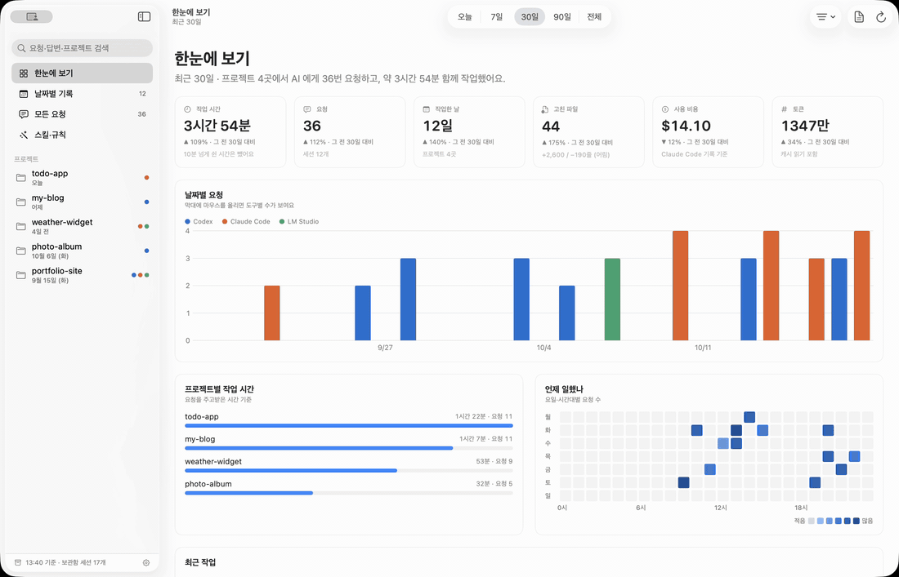
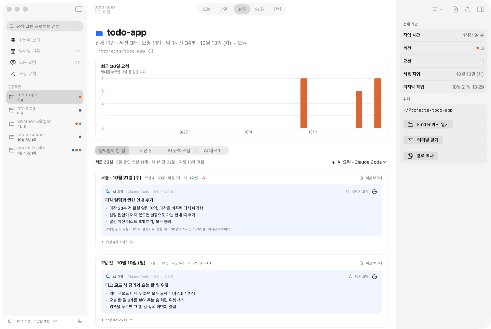
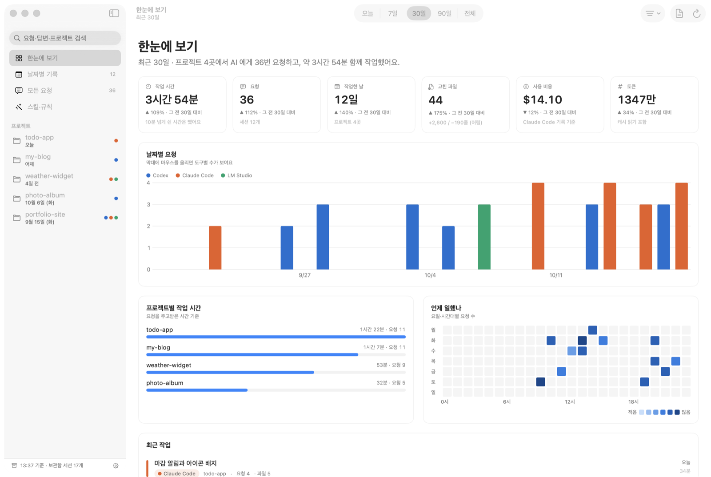
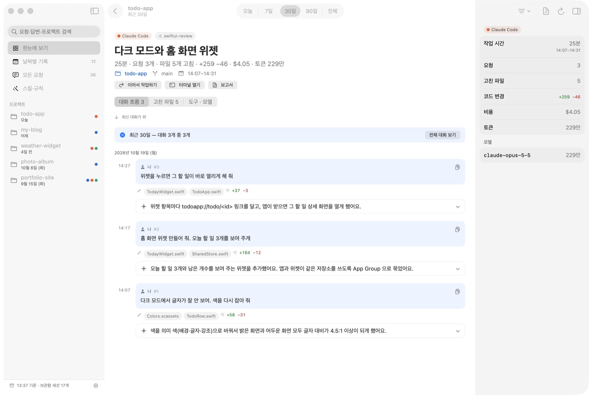
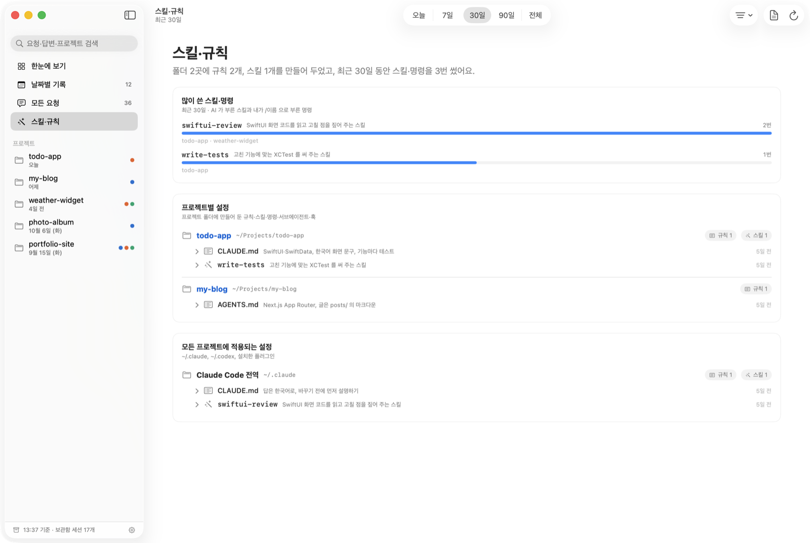
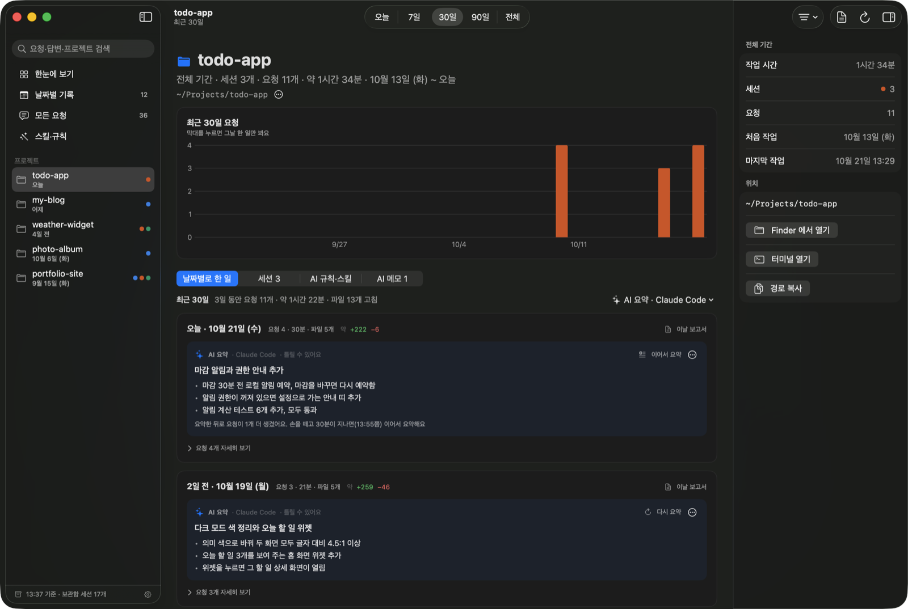
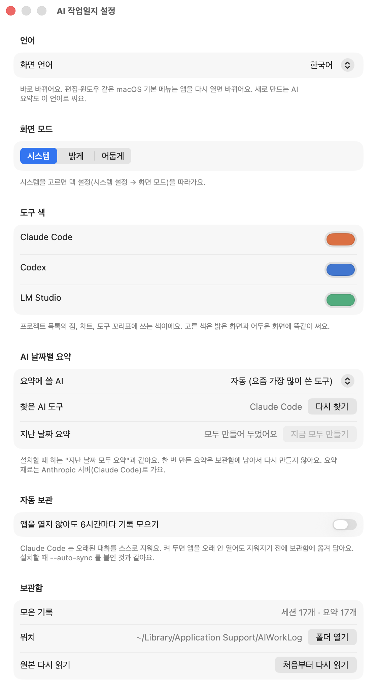

# AI 작업일지

**한국어** · [English](README.en.md)

<p align="center">
  
  <br><sub>20초 시연 (<a href="docs/demo-ko.mp4">MP4 로 보기</a>) · 지어낸 예시 기록으로 찍었어요</sub>
</p>

내 맥에서 AI(Claude Code, Codex, LM Studio)와 함께 한 일을 **날짜별 일기장**처럼 모아 보여 주는 맥 앱이에요.

<p align="center">
  <a href="https://github.com/whalebanana86/ai-worklog/releases/latest"><b>⬇︎ 내려받기 (macOS 14+, Apple 실리콘·인텔)</b></a>
</p>

## 이 앱은 뭐예요?

요즘은 컴퓨터에게 말로 일을 시킬 수 있어요. "로그인 버튼 고쳐 줘", "그래프 그려 줘" 하고 AI 에게 부탁하면 AI 가 대신 코드를 써 줘요.

이 앱은 그렇게 **AI 와 나눈 이야기를 전부 모아서**, 날마다 "오늘 무엇을 했는지"를 짧게 정리해 보여 줘요.
마치 선생님이 하루 동안 한 일을 알림장에 몇 줄로 적어 주는 것처럼요.



> 이 README 의 그림은 모두 지어낸 예시 기록(할 일 앱·블로그·날씨 위젯·사진 앨범·포트폴리오 사이트)으로 찍었어요. 앱을 `--demo` 로 띄우면 똑같이 볼 수 있어요.

## 왜 만들었어요?

AI 에게 일을 많이 시키다 보면 이런 일이 생겨요.

1. **"그래서 내가 뭘 했더라?"** — 하루에 수십 번씩 부탁하다 보면, 저녁이 되면 무엇을 끝냈는지 잘 기억나지 않아요.
2. **기록이 너무 길고 흩어져 있어요** — 대화 기록은 컴퓨터 여기저기 다른 곳에, 사람이 읽기 어려운 모양으로 숨어 있어요. 한 번 대화에 글이 책 한 권만큼 쌓이기도 해요.
3. **기록이 저절로 지워져요** — Claude Code 는 오래된 대화를 스스로 지워 버려요. 그냥 두면 지난달에 한 일을 다시 볼 수 없어요.

그래서 이 앱은

- 흩어진 기록을 **한곳에 모으고**,
- 지워지기 전에 **내 컴퓨터 안 상자(보관함)에 옮겨 담아** 두고,
- 긴 대화를 **"이날 한 일" 몇 줄로 줄여서** 보여 줘요.

하고 싶은 말은 하나예요. **"AI 로 뭔가 했는데, 결국 뭘 했는지"를 한눈에 알고 싶다!**

## 설치하는 방법

### 가장 쉬운 방법: 내려받기

1. [Releases 페이지](https://github.com/whalebanana86/ai-worklog/releases/latest)에서 `AI-Worklog-…-macOS.dmg` 를 내려받아요.
2. 내려받은 파일을 열고, **AI 작업일지** 아이콘을 옆의 **Applications(응용 프로그램)** 폴더로 끌어다 놓아요.
3. 응용 프로그램 폴더에서 앱을 열어요.
   - "확인할 수 없는 개발자" 같은 창이 뜨면 **시스템 설정 → 개인정보 보호 및 보안** 맨 아래의 **그래도 열기**를 눌러요. (Apple 공증을 받기 전 버전이라 처음 한 번만 그래요. 공증 받은 버전이면 바로 열려요.)
   - 터미널이 익숙하면 `xattr -dr com.apple.quarantine "/Applications/AI 작업일지.app"` 한 줄로도 돼요.
4. 처음 열면 지금까지의 AI 기록을 한 번 다 읽어요(조금 걸려요). 지난 날짜 AI 요약을 한꺼번에 만들려면 **설정(⌘,) → 지금 모두 만들기**를 눌러요.

### 코드로 직접 만들어 설치하기

#### 준비물

- 맥 컴퓨터 (macOS 14 Sonoma 이상)
- Xcode 또는 개발 도구 — 없으면 터미널에서 `xcode-select --install` 을 한 번 실행해요
- (있으면 좋아요) Claude Code, Codex, LM Studio 중 하나 — 있어야 AI 가 "이날 한 일"을 요약해 줘요. 없어도 앱은 돼요

#### 따라 하기

1. **터미널을 열어요.** 터미널은 글자로 컴퓨터에게 명령하는 창이에요. `⌘ + 스페이스`를 누르고 "터미널"이라고 쓴 뒤 엔터를 쳐요.
2. **이 앱의 코드를 내려받아요.** 아래 줄을 복사해서 터미널에 붙여 넣고 엔터를 쳐요.
   ```bash
   git clone https://github.com/whalebanana86/ai-worklog.git
   cd ai-worklog
   ```
3. **앱을 만들고 설치해요.**
   ```bash
   scripts/build_app.sh --install
   ```
   이 명령이 세 가지를 차례로 해요.
   - 코드를 앱으로 만들어서 내 `응용 프로그램` 폴더(`~/Applications`)에 넣어요.
   - 지금까지의 AI 대화 기록을 읽어 보관함에 담아요. (처음 한 번만 조금 걸려요)
   - 지난 날짜마다 "이날 한 일"을 AI 에게 한 번씩 요약받아 저장해요. 기록이 많으면 몇 분 걸려요. 한 번 만들어 두면 다시 만들지 않아서 AI 사용량을 아껴요.

   AI 요약을 미리 만들고 싶지 않으면 `scripts/build_app.sh --install --no-summary` 를 쓰면 돼요.
4. **앱을 열어요.** Finder 에서 `홈 폴더 → 응용 프로그램 → AI 작업일지`를 더블클릭해요.

### 새 버전으로 바꾸기 · 지우기

- 새 버전: 내려받아 쓰면 새 DMG 로 앱을 바꿔 끼워요. 코드로 설치했으면 `ai-worklog` 폴더에서 `git pull` 한 다음 `scripts/build_app.sh --install` 을 다시 해요. 모아 둔 기록과 요약은 그대로 남아요.
- 지우기: 앱(`AI 작업일지.app`)을 휴지통에 넣어요. 모아 둔 기록까지 지우려면 `~/Library/Application Support/AIWorkLog` 폴더도 지워요.

## 쓰는 방법

### 왼쪽 목록



| 메뉴 | 무엇을 보여 줘요? |
|---|---|
| 한눈에 보기 | 얼마나 오래 일했는지, AI 에게 몇 번 부탁했는지, 어느 날 많이 일했는지 그래프로 보여 줘요 |
| 날짜별 기록 | 날마다 어떤 프로젝트에서 무엇을 했는지 |
| 모든 요청 | 내가 AI 에게 보낸 부탁 전부. 검색도 돼요 |
| 스킬·규칙 | AI 에게 미리 가르쳐 둔 규칙과 기술(스킬) 목록, 많이 쓴 순서 |
| 프로젝트 이름들 | 프로젝트마다 따로 모아 보기 (아래 설명) |

### 프로젝트 화면 = 이 앱의 핵심

1. 왼쪽에서 프로젝트 이름을 눌러요.
2. **날짜별로 한 일** 탭에 날짜마다 카드가 하나씩 있어요.
3. 카드 맨 위 **AI 요약** 상자에 "이날 한 일" 한 줄과 중요한 결과 몇 줄이 적혀 있어요. 끝내지 못한 일은 "남은 일"로 알려 줘요.
4. 더 자세히 보고 싶으면 **요청 N개 자세히 보기**를 눌러요. 내가 한 부탁 → AI 가 한 일 → 고친 파일이 순서대로 나와요.
5. 부탁 하나를 누르면 그때 AI 와 나눈 대화 전체를 볼 수 있어요.
6. 오른쪽 **정보 패널**에 작업 시간·세션·요청 수와 Finder·터미널 열기가 모여 있어요. 툴바 버튼이나 `⌥⌘I` 로 열고 닫아요.

AI 요약은 틀릴 수 있어요. 그래서 요약 상자 오른쪽 `…` 메뉴로

- **고치기…** — 한 줄과 결과를 내가 직접 고쳐요. "직접 고침" 표시가 붙어요.
- **전 요약으로 되돌리기** — 바로 전 판으로 돌아가요. 한 번 더 누르면 다시 앞으로 와요.
- 고치거나 되돌린 요약은 새 요청이 생겨도 **저절로 바꾸지 않아요**. 다시 쓰고 싶을 때만 요약 버튼을 눌러요.



### 오늘 요약은 언제 생겨요?

- 일하는 동안에는 기다려요. 마지막 부탁 뒤로 **30분 동안 쉬면** 그때 요약해요. 카드에 "09:17쯤 요약해요"처럼 알려 줘요.
- 기다리기 싫으면 **지금까지 요약** 버튼을 눌러요.
- 이미 요약이 있으면 **새로 한 부탁만** 더해서 고쳐 써요. 처음부터 다시 쓰는 것보다 AI 사용량이 적어요.
- 하루가 끝나면 마지막으로 한 번 정리해서 그날 요약을 확정해요.

### AI 가 없으면요?

- 요약해 줄 AI(Claude Code, Codex, LM Studio)가 하나도 없어도 앱은 그대로 써요. 날짜 카드에 요청 → AI 가 한 일 → 고친 파일 목록이 보여요.
- 목록 위에 "요약해 줄 AI 를 찾지 못했어요" 안내가 떠요. 필요 없으면 ✕ 로 닫아요.
- 전에 만들어 둔 요약은 AI 가 없어도 **그대로 보여요**. 새로 만들거나 이어 쓰는 버튼만 숨어요.
- 나중에 Claude Code·Codex 를 설치하거나 LM Studio 서버를 켜면, 앱으로 돌아올 때 알아서 다시 찾아요.

### 그 밖에

- 위쪽 **오늘 · 7일 · 30일 · 90일 · 전체** 버튼으로 보고 싶은 기간을 골라요.
- 한눈에 보기의 숫자마다 **그 전 같은 기간과 견준 변화**가 붙어요. (예: ▲ 12% · 그 전 30일 대비)
- 왼쪽 위 **검색 칸**에 글자를 쓰면 그 글자가 들어간 부탁과 답만 보여요.
- 그래프의 **막대를 누르면** 그날 한 일만 보여요.
- 세션 줄이나 왼쪽 프로젝트를 **오른쪽 클릭**하면 세션 열기·요청 복사·이어서 작업하기·터미널 열기·Finder 에서 보기 같은 메뉴가 나와요.
- 날짜별 기록·모든 요청 목록은 **화살표로 고르고 Return** 으로 열어요.
- **이날 보고서** 버튼을 누르면 그날 한 일을 글로 정리해 줘요. 복사하거나 파일로 저장할 수 있어요.
- 오른쪽 위 **AI 요약** 메뉴에서 요약해 줄 AI 를 고르거나 끌 수 있어요. "자동"은 내가 요즘 가장 많이 쓴 AI 를 골라요.
- **스킬·규칙** 화면에서는 AI 에게 미리 가르쳐 둔 규칙 파일과 스킬, 많이 쓴 순서를 볼 수 있어요.
- 어두운 화면(다크 모드)도 돼요. 평소엔 맥 설정을 따라가고, **설정 → 화면 모드**에서 밝게·어둡게로 고정할 수도 있어요.
- 화면 언어를 **한국어 · English · 日本語** 중에서 고를 수 있어요 (설정 → 언어). 새로 만드는 AI 요약도 그 언어로 써요.
- 단축키: `⌘1`~`⌘4` 화면 바꾸기, `⌘R` 새로 고침, `⌘E` 보고서, `⌥⌘I` 정보 패널, `⌘,` 설정, `⌘[` 뒤로 가기

<p>
  
  
</p>

### 앱 안에서 바꾸는 설정 (⌘,)

설치할 때 고르던 옵션을 앱 안에서도 켜고 끌 수 있어요. 메뉴 막대의 **AI 작업일지 → 설정…** 이나 왼쪽 아래 톱니바퀴를 눌러요.

| 설정 | 하는 일 | 설치 옵션으로는 |
|---|---|---|
| 언어 | 한국어 / English / 日本語. 바로 바뀌어요 | — |
| 화면 모드 | 시스템(맥 설정 따르기) / 밝게 / 어둡게. 바로 바뀌어요 | — |
| 도구 색 | 프로젝트 목록의 점·차트·꼬리표에 쓰는 Claude Code(주황)·Codex(파랑)·LM Studio(초록) 색을 바꿔요 | — |
| 요약에 쓸 AI | 자동 / Claude Code / Codex / LM Studio / 끄기 | — |
| 지난 날짜 요약 · **지금 모두 만들기** | 아직 요약이 없는 지난 날을 한꺼번에 요약해 저장해요. 중간에 멈출 수 있어요 | `--install` (빼려면 `--no-summary`) |
| 자동 보관 | 앱을 열지 않아도 6시간마다 기록을 모아요. Claude Code 가 지우기 전에 옮겨 담아요 | `--auto-sync` / `--remove-auto-sync` |
| 보관함 | 모은 기록 수, 폴더 열기, 원본 처음부터 다시 읽기 | — |



## 내 기록은 안전해요?

- 모은 기록은 **내 컴퓨터 안에만** 저장돼요.
- 앱은 원래 기록을 **읽기만** 하고 고치거나 지우지 않아요.
- 비밀번호 같은 값이 들어 있을 수 있는 설정 파일은 내용을 보여 주지 않고 요약만 보여 줘요.
- **딱 하나 밖으로 나가는 것**: AI 요약을 켜 두면, 요약을 만들려고 그날 부탁과 결과를 고른 AI 에게 보내요 (Claude Code 는 Anthropic, Codex 는 OpenAI). LM Studio 를 고르면 내 컴퓨터 안에서만 처리해요. 싫으면 AI 요약 메뉴에서 **끄기**를 고르면 돼요.

---

## 더 자세한 설명 (어른·개발자용)

### 화면

| 화면 | 보여 주는 것 |
|---|---|
| 한눈에 보기 | 기간(오늘·7일·30일·90일·전체)별 작업 시간, 요청 수, 작업한 날, 고친 파일, 비용, 토큰 · 날짜별 요청 막대(도구별) · 프로젝트별 작업 시간 · 요일×시간 히트맵 · 최근 작업 · 많이 쓴 도구·모델 |
| 날짜별 기록 | 날마다 어떤 프로젝트에서 무엇을 했는지(첫 요청과 AI 가 마지막으로 해낸 결과 한 줄). 며칠에 걸친 세션은 날마다 그날 한 만큼만 나온다. "이날 보고서" 버튼 |
| 모든 요청 | 내가 AI 에게 보낸 요청 전부. 왼쪽 위 검색으로 요청·답변 내용 검색 |
| 스킬·규칙 | 많이 쓴 스킬·명령 순위, 프로젝트마다 만들어 둔 규칙(CLAUDE.md·AGENTS.md…)·스킬·명령·서브에이전트·훅, 전역(~/.claude, ~/.codex, 플러그인) 설정 |
| 프로젝트 | 프로젝트별 통계 · 요청 막대(누르면 그날만) · 탭: **날짜별로 한 일**(날마다 **AI 가 쓴 요약** 한 줄 + 핵심 결과 몇 줄, 그 아래 접힌 요청 → AI 결과 한 줄 → 고친 파일, 이날 보고서) / 세션 / **AI 규칙·스킬**(이 폴더와 상위 폴더 것, 실제로 쓴 스킬) / AI 메모 |
| 세션 | 대화 흐름은 최신이 맨 위. 요청마다 고친 파일, AI 의 마지막 답은 한 줄(누르면 전체). 위쪽 검색어·기간으로 대화를 거르고 검색어는 형광펜 표시("전체 대화 보기"로 해제). 고친 파일 전체, 쓴 도구·모델·비용. "이어서 작업하기"는 `claude --resume …` 명령을 복사 |
| 보고서 (⌘E) | 지금 기간·하루·세션을 마크다운으로 정리. 고쳐서 복사하거나 .md 로 저장 |

긴 목록(세션 대화 25개, 날짜별 기록 14일, 모든 요청 60개, 프로젝트 날짜별 7일·세션 20개씩)은 아래로 내리면 이어서 불러온다.

단축키: ⌘1~4 화면 전환, ⌘R 새로 고침, ⌘E 보고서, ⌘[ 뒤로.

### AI 날짜별 요약

프로젝트 화면의 "날짜별로 한 일"에서, 이 맥에 AI 도구가 있으면 날마다 그날 요청·결과를 AI 에게 맡겨 "결국 무엇을 했는지" 정리해 보여 준다.

| 도구 | 부르는 방법 | 재료가 가는 곳 |
|---|---|---|
| Claude Code | `claude -p --model haiku` (도구·MCP·스킬·훅 끔, `--no-session-persistence`) | Anthropic 서버 |
| Codex | `codex exec --ephemeral -s read-only --ignore-user-config` (셸·앱 연결·플러그인·훅·웹 검색 끔, 내 `config.toml`·MCP 서버는 읽지 않아 Codex 기본 모델로 요약, 생각 짧게) | OpenAI 서버 |
| LM Studio | 켜 둔 로컬 서버 `/v1/chat/completions` | 내 맥 안 |

- 오른쪽 위 **AI 요약** 메뉴에서 고른다. "자동"은 찾은 도구 중 최근 30일에 가장 많이 쓴 것(클라우드 도구가 없으면 LM Studio). "끄기"를 고르면 예전처럼 요청 목록만 보인다
- **설치할 때 지난 날짜를 모두 한 번 요약해** 보관함(`day_summaries`)에 남긴다 (`AIWorkLog cli --summarize`, 만든 사람 맥에서는 프로젝트·날짜 174개에 6분). 앱은 저장된 요약을 불러 보여 주기만 해서 토큰을 다시 쓰지 않는다. 중간에 멈추거나 다시 설치하면 남은 날만 한다. 건너뛰려면 `--install --no-summary`
- **오늘**: 일하는 중에는 부르지 않는다. 마지막 요청 뒤 30분 동안 새 요청이 없으면(손을 뗐으면) 그때 요약하고, 이미 요약이 있으면 "지금까지 요약 + 그 뒤 새 요청"만 보내 **이어 쓴다**. 기다리는 동안은 "09:17쯤 요약해요"처럼 알려 주고, "지금까지 요약"·"이어서 요약" 버튼으로 바로 할 수도 있다
- **날이 끝나면**: 그날 도중에 만든 요약에 남은 요청만 더해 한 번 마감한다. 앱을 열면 최근 일주일 안의 마감할 날을 알아서 처리하고(보통 어제 것 몇 개), 설치 때 `--summarize` 도 마감할 날을 함께 처리한다
- **마감한 지난 날**은 다시 부르지 않는다. 그 뒤로 요청이 늘었으면 "요청이 N개 더 생겼어요"라고만 알리고, "이어서 요약"을 누르면 새 요청만 더한다. 새 요청이 없을 때 "다시 요약"은 처음부터 다시 만든다
- 실제 하루 기록(요청 18개)으로 앞 절반 요약에 뒤 절반을 이어 쓰니 앞 내용이 그대로 살아 있었고, 보낸 재료는 전체 5,120자 대신 4,180자였다
- 요약하러 부른 대화는 기록을 남기지 않는 방식으로만 불러서, 이 앱의 작업 기록에 다시 섞이지 않는다
- 요약 재료: 그 프로젝트의 그날 세션(자동 실행 세션 제외)에서 사람이 보낸 요청, AI 의 마지막 답, 고친 파일 이름. 요청이 많은 날은 하나하나를 짧게 잘라 9천 자 안팎으로 맞춘다
- "이날 보고서"에도 요약이 맨 위에 들어간다
- 시간: 프로젝트 하나·하루에 Claude Code 3~15초, Codex 5~6초 (2026-10-19 측정)

### 읽는 기록

| 도구 | 위치 | 내용 |
|---|---|---|
| Claude Code | `~/.claude/projects/*/*.jsonl` | 대화 원본: 요청, 답변, 고친 파일, 도구, 스킬, 비용(cost-state) |
| Claude Code | `~/.claude/history.jsonl` | 입력한 요청만 (대화 원본이 지워진 세션도 남아 있음) |
| Claude Code | `~/.claude/projects/*/memory/*.md` | AI 가 프로젝트에 대해 기억해 둔 메모 |
| Codex | `~/.codex/state_*.sqlite`, `thread_history_*.sqlite` | 스레드 목록·대화 (읽기 전용으로 엶) |
| LM Studio | `~/.lmstudio/conversations/*.conversation.json` | 로컬 모델 대화 |
| 스킬·규칙 | 각 프로젝트와 상위 폴더의 `CLAUDE.md`, `AGENTS.md`, `.claude/skills`, `.agents/skills`, `.claude/commands`, `.claude/agents`, `.claude/settings.json`, `.mcp.json` | 설정 파일. `settings.json`·`.mcp.json` 은 비밀값이 있을 수 있어 **요약만** 보여 준다 |

- AI 를 상위 폴더(`~/Workspaces`)에서 띄우고 하위 프로젝트(`my-app`)만 고쳤다면, 그 세션은 하위 프로젝트로 묶는다.
- 문서·데스크탑·다운로드 폴더는 들여다보지 않는다 (macOS 가 접근 허락 창을 띄우기 때문).
- 사람이 아닌 것이 돌린 세션은 "자동 실행"으로 보고 숨긴다 (필터 → **자동 실행 세션도 보기**로 볼 수 있다): `claude -p` 로 부른 보조 호출(대화 제목·브랜치 이름 짓기 등), 임시 폴더(`/tmp`, `/var/folders`)에서 돈 시험 도구(E2E 등) 세션, 예약 작업. Agent SDK 로 Claude Code 를 품은 앱(`sdk-ts`·`sdk-py`)에서 쓴 요청은 사람 작업으로 센다.

### 보관함 (기록 분실 방지)

Claude Code 는 오래된 대화 원본을 스스로 지운다. 이 앱은 읽은 내용을 SQLite 보관함에 쌓아서 원본이 지워져도 남긴다.

- 위치: `~/Library/Application Support/AIWorkLog/worklog.sqlite` (메뉴 **기록 → 보관함 폴더 열기**)
- 남기는 것: 세션, 내가 보낸 요청 전부(붙여넣은 내용 포함), 요청마다 AI 의 마지막 답, 고친 파일, 쓴 도구·스킬, 모델별 토큰·비용, AI 메모
- 남기지 않는 것: 도구 실행 결과, AI 의 중간 메시지, 생각 과정, 이미지 (용량이 커서). 요청·답은 2만 자가 넘으면 자른다
- 처음 한 번은 원본 전체를 읽어 채우고(1~2초), 다음부터는 보관함에서 바로 띄운 뒤 늘어난 부분만 읽는다(0.2초 안팎)
- 원본이 지워진 세션은 "보관본"으로 표시된다. 이 앱을 설치하기 **전에** 이미 지워진 대화는 되살릴 수 없어서 "요청만 남음"으로 보인다
- 표: `sessions`, `prompts`, `notes`, `sources`(원본을 어디까지 읽었는지), `day_summaries`(AI 날짜별 요약). `sqlite3` 로 직접 열어 봐도 된다

### 설치 옵션

```bash
scripts/build_app.sh --install              # ~/Applications 에 설치하고 보관함을 미리 채운다 + 지난 날짜 AI 요약
scripts/build_app.sh --install --no-summary # AI 요약은 미리 만들지 않는다
scripts/build_app.sh --install --auto-sync  # + 앱을 안 열어도 6시간마다 보관함 갱신 (launchd)
scripts/build_app.sh --remove-auto-sync     # 자동 보관 끄기
```

앱을 오래 안 열면 그 사이 Claude Code 가 지운 대화는 보관함에 들어가지 못한다. 그게 걱정되면 `--auto-sync` 를 켠다 (앱 설정의 "자동 보관"과 같은 것).
`~/Library/LaunchAgents` 폴더가 관리자(root) 것이면(다른 프로그램 설치기가 만든 경우) 켜지지 않는다. 그때는 `sudo chown $USER ~/Library/LaunchAgents` 를 한 번 실행한다.
개발자 인증서 없이 임시 서명하므로 내 맥에서 쓰는 용도다.

설치한 앱 하나로 터미널 명령도 된다 (설치 스크립트·자동 보관이 이걸 쓴다):

```bash
"$HOME/Applications/AI 작업일지.app/Contents/MacOS/AIWorkLog" cli --quiet   # 보관함만 갱신
"$HOME/Applications/AI 작업일지.app/Contents/MacOS/AIWorkLog" cli --day 2026-10-16
"$HOME/Applications/AI 작업일지.app/Contents/MacOS/AIWorkLog" cli --day 2026-10-16 --ai claude   # 그날 프로젝트마다 AI 요약 (codex·lmstudio 도 됨)
"$HOME/Applications/AI 작업일지.app/Contents/MacOS/AIWorkLog" cli --summarize            # 아직 요약 없는 지난 날짜 모두 요약 (--dry-run: 몇 개인지만)
"$HOME/Applications/AI 작업일지.app/Contents/MacOS/AIWorkLog" cli --auto-sync on        # 자동 보관 켜기 (off: 끄기, status: 상태)
```

#### 가볍게 만든 방법 (2026-10-16 측정)

| | 전 | 후 |
|---|---|---|
| 앱 용량 | 5.1MB | 1.5MB — 크기 우선 최적화(-Osize) + 디버그 기호 제거, CLI 를 앱 실행 파일의 `cli` 모드로 합침, 아이콘 256색(525KB → 49KB) |
| 보관함 | 6.2MB + 쓰기 대기 4.5MB | 3.7MB + 0 — 읽기 상태에서 요청 중복 저장 제거(2.5MB → 0.1MB), 저장 뒤 WAL 정리·빈 공간 많으면 VACUUM |
| 실행 중 메모리 | 대시보드 156MB, 큰 세션 169MB | 139~143MB, 154MB |

아이콘은 그라데이션·반투명 그림자가 256색에서 줄무늬·회색 테두리로 깨져서 단색 바탕으로 바꿨다.

### 개발

```bash
swift build                    # 앱 + CLI
swift test                     # 파서·보관함·설정 찾기 테스트
swift run worklog-cli          # 앱과 같은 코드로 읽어 터미널에 요약
swift run worklog-cli --day 2026-10-16      # 그날 보고서
swift run worklog-cli --day 2026-10-16 --ai codex   # 그날 프로젝트마다 AI 요약 (보관함에 남아 앱이 그대로 씀)
swift run worklog-cli --session <id 앞부분>  # 세션 하나 자세히
swift run worklog-cli --no-store            # 보관함 없이 원본만 읽기
scripts/screenshot.sh /tmp/a.png --demo --screen skills   # 앱 창만 캡처 (켜 둔 앱은 그대로 둔다)
```

앱 실행 옵션(화면 확인용): `--screen timeline|prompts|skills|project=<경로>`, `--period today|week|month|quarter|all`,
`--session <id>`, `--search <글>`, `--report`, `--settings`(설정 창 열기), `--dark`(이번에만 어둡게, 저장하지 않음), `--frame x,y,w,h`, `--hover-day yyyy-MM-dd`(차트에 마우스를 올린 상태),
`--demo`(지어낸 기록으로 띄우기 — 실제 기록·보관함을 읽지 않고 AI 도 부르지 않음. README 그림은 이걸로 찍었다),
`--no-ai`(요약할 AI 가 하나도 없는 척하기), `--tab worklog|sessions|setup|notes`(프로젝트 화면 시작 탭), `--tools codex,lmStudio`(도구 거르기),
`--tool-colors claudeCode=8E44AD,codex=2E9E4F`(이번에만 도구 색 바꾸기, 저장하지 않음), `--lang ko|en|ja`(이번에만 그 언어로, 저장하지 않음), `--tour`(시연 영상용 자동 둘러보기).

README 그림·시연 영상 다시 만들기 (지어낸 기록으로만 찍는다).
캡처 스크립트는 앱 ID 만 바꾼 사본(`build/demo/AIWorkLogDemo.app`, `local.aiworklog.demo`)을 빈 설정으로 띄워 찍고 끈다.
켜 둔 앱을 끄지 않고, 그 창·패널 크기 설정도 건드리지 않는다. 창 자리는 `FRAME=x,y,w,h` 로 바꾼다.

```bash
scripts/make_screenshots.sh ko        # docs/screenshots/*.png  (en → docs/screenshots/en/)
scripts/make_demo_video.sh ko         # docs/demo-ko.gif·mp4 (앱 창만 ScreenCaptureKit 으로 녹화, ffmpeg 필요)
```

화면 글자 번역: 한국어 원문을 그대로 열쇠로 써서 `L("요청 %@개", n)` 처럼 부르고, 영어·일본어는 `Sources/WorkLogCore/Translations.swift` 에 있다.
새 글을 넣고 번역을 빠뜨리면 `swift test` 의 `testEveryScreenTextHasTranslations` 가 알려 준다.

#### 배포 (GitHub Releases)

`v1.2.3` 같은 태그를 올리면 GitHub Actions(`.github/workflows/release.yml`)가 Apple 실리콘·인텔 겸용 앱을 만들어 DMG·zip 으로 Releases 에 올린다.
로컬에서는 `scripts/package_release.sh 1.2.3` → `build/release/`.

서명·공증: 저장소 **Settings → Secrets and variables → Actions** 에 아래 값을 넣으면 Developer ID 로 서명하고 Apple 공증까지 받는다. 없으면 임시 서명으로 올린다.

| Secret | 내용 |
|---|---|
| `MACOS_CERT_P12` | Developer ID Application 인증서(.p12)를 `base64 -i cert.p12` 로 바꾼 글 |
| `MACOS_CERT_PASSWORD` | 그 .p12 의 암호 |
| `MACOS_SIGN_IDENTITY` | 예) `Developer ID Application: Your Name (TEAMID)` |
| `APPLE_ID` · `APPLE_TEAM_ID` · `APPLE_APP_PASSWORD` | 공증용 Apple ID, 팀 ID, 앱 암호(appleid.apple.com 에서 만든 것) |

구성:
- `Sources/WorkLogCore` — 기록 읽기(`ClaudeCodeSource`, `CodexSource`, `LMStudioSource`), 보관함(`WorkLogStore`), 설정 찾기(`AIConfig`), AI 날짜별 요약(`DaySummarizer`), 통계·보고서
- `Sources/AIWorkLog` — SwiftUI 앱
- `Sources/worklog-cli` — 개발용 CLI (`WorkLogCommand` 를 부르기만 함. 설치본은 `AIWorkLog cli` 로 같은 기능)

### 아직 안 되는 것

- 비용은 Claude Code 기록에 비용 정보가 있는 세션만 나온다. Codex 는 토큰 합계만.
- 고친 줄 수는 편집 내용으로 어림한 값이라 실제 diff 보다 조금 많다.
- Gemini(Antigravity)는 기록이 protobuf 라 아직 읽지 않는다. Ollama CLI 기록은 시각이 없어 뺐다.
