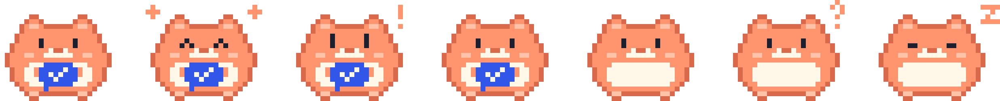

# 이걸내가 브랜드

| 언어 | 이름 | 부제 |
|---|---|---|
| 한국어 | 이걸내가 | AI와 함께한 일 |
| English | I Did That? | What I did with AI |
| 日本語 | これ、私が？ | AIと一緒にやったこと |

## 서비스 설명

**한국어**

이걸내가는 Claude Code·Codex·LM Studio와 함께한 작업을 날짜와 프로젝트별로 모아 보는 맥 앱입니다.
요청, 답변, 고친 파일과 AI 요약을 돌아보며 내가 해낸 일을 발견하세요.

짧은 소개: **흩어진 AI 작업 기록을 모아, 내가 해낸 일을 발견하는 맥 앱.**

**English**

I Did That? gathers your work with Claude Code, Codex and LM Studio by date and project.
Look back at prompts, replies, changed files and AI summaries to rediscover what you accomplished.

Short description: **A Mac app to gather your AI work and rediscover what you accomplished.**

**日本語**

これ、私が？は、Claude Code・Codex・LM Studioと一緒に行った作業を、日付とプロジェクト別にまとめるMacアプリです。
依頼、回答、変更したファイル、AIの要約を振り返り、自分が成し遂げたことを再発見できます。

短い紹介: **散らばったAIとの作業記録をまとめ、自分が成し遂げたことを再発見するMacアプリ。**

## アイコン / 아이콘


말풍선은 “내가 이걸 했다고?”라는 발견, 큰 체크는 해낸 일, 작은 느낌표는 새삼스러운 놀라움을 나타냅니다.
파랑 `#3156E8`, 크림 `#FFF8E8`, 체크 `#2549D6`, 코랄 `#FF956E`를 사용합니다.
글자 없는 도형으로 작은 Dock·Finder 아이콘에서도 읽히게 구성했습니다.

- 원본: `scripts/make_icon.swift` (AppKit/Core Graphics로 재현 가능)
- 배포용: `Support/AppIcon.icns` (16–1024px)
- 미리보기: `docs/brand/app-icon.png` (512px)

```bash
swift scripts/make_icon.swift build.noindex/brand
python3 scripts/compress_icon.py build.noindex/brand/AppIcon.iconset Support/AppIcon.icns
cp build.noindex/brand/AppIcon.iconset/icon_512x512.png docs/brand/app-icon.png
```

## 캐릭터 / キャラクター

<p align="center"></p>

**모아**(Moa / モア)는 흩어진 AI 작업 기록을 볼에 모으는 햄스터예요. 품에 안은 파란 말풍선과 체크가 앱 아이콘이에요.
몇 가지 색의 픽셀로만 그려서 앱 화면·터미널·홍보 그림이 같은 격자를 써요.



| 자세 (왼쪽부터) | 나오는 곳 |
|---|---|
| 평소 | 한눈에 보기 오른쪽 위 (가끔 깜빡이고 통통 뛰어요), 업데이트 창에서 최신 버전일 때 |
| 뿌듯 | 한눈에 보기에서 지난 기간보다 더 오래 일했을 때 (반짝임) |
| 새 소식 | 업데이트 창에 새 버전이 있을 때 (아이콘의 코랄 느낌표) |
| 모으는 중 | 처음 기록을 읽을 때, 업데이트 확인·설치 중 (볼이 부풀었다 줄었다) |
| 빈손 | 아직 모은 기록이 없을 때 |
| 갸웃 | 검색·도구 거르기에 맞는 기록이 없을 때, 업데이트 오류 |
| 잠 | 고른 기간에 기록이 없을 때 |

털 코랄 `#FF956E`, 테두리·코 `#D9694A`, 볼·귀 `#FFC2A8`, 배 크림 `#FFF8E8`, 눈 `#1B1F2E`, 말풍선 파랑 `#3156E8`을 써요.
꾸밈 그림이라 VoiceOver 에는 읽히지 않고, 시스템 설정의 '동작 줄이기'를 켜면 움직이지 않아요.
데이터 화면(차트·세션·요약)에는 넣지 않고 기다릴 때·비었을 때·해냈을 때만 나와요. 16px 처럼 아주 작게 쓰면 주황 덩어리로만 보여서 메뉴 막대·툴바에도 쓰지 않아요.

- 원본 격자: `Sources/WorkLogCore/Mascot.swift` (앱·터미널·그림이 모두 이것을 써요)
- 그림: `docs/brand/moa.gif`(평소 움직임) · `moa-poses.png`(자세 모음) · `moa.png`(한 장, 홍보 영상 끝 카드)
- 터미널: `AIWorkLog cli --moa` (설치 스크립트 끝 인사)

```bash
swiftc -O -parse-as-library Sources/WorkLogCore/Mascot.swift scripts/make_mascot.swift -o build.noindex/make_mascot
build.noindex/make_mascot docs/brand
```

앱 이름 변경 후에도 bundle ID `local.aiworklog`, 실행 파일 `AIWorkLog`, 저장 폴더 `AIWorkLog`,
GitHub 저장소 주소는 호환성을 위해 유지합니다. 저장된 기록·설정과 업데이트 확인이 이어집니다.
